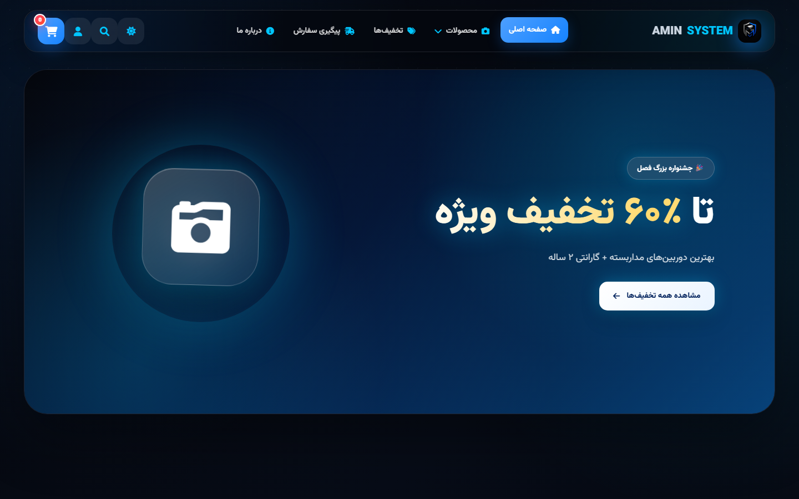

# PersianBlue CCTV

A complete online store for security cameras, with an admin panel that runs on its own isolated server.



## Overview

A Persian-language shop for cameras, recorders, complete packages and accessories. Customers browse and filter the catalog, open a product, fill a cart, check out, and later follow their order with a tracking page.

Staff manage the shop from an admin panel: a dashboard, orders, products, and a banner manager that controls the carousel on the home page.

## Features

- **Catalog and filters.** Search by name or description and filter by cameras, recorders, packages, accessories, discounted and best-selling.
- **Cart and checkout.** A persistent cart, a cart page and a checkout form that creates the order.
- **Order tracking.** Customers follow an order by its code and see their order history in their account.
- **Banner manager.** The home-page carousel is edited from the admin panel, not hard-coded.
- **Admin dashboard.** Orders, products and customers at a glance for the shop staff.
- **Dark mode.** A theme switch with a full dark palette across the storefront.

## Engineering notes

- **Admin panel off the public internet.** The storefront server never serves admin files. Administration runs as a second process with its own session, so a public visitor has no route to it.
- **Separate customer and staff sessions.** Customer accounts and staff accounts use different session stores and different secrets.
- **No framework, real structure.** Two dozen plain JavaScript modules, each owning one concern: store, cart, catalog, checkout, auth, orders, theme, carousel.
- **REST routes split by audience.** Public routes for products, orders, customers and banners, kept apart from the administrative ones.
- **Right-to-left throughout.** Layout, typography and numerals designed for Persian readers.

## Architecture

| Layer | What it does |
| --- | --- |
| Storefront | Home, catalog, product, cart, checkout, account, tracking |
| Public server | Express, customer sessions, public product, order and banner routes |
| Admin server | Separate Express process and session for staff |
| Admin panel | Dashboard, orders, products, banners |

## Tech stack

- **Frontend:** HTML5, CSS3, Vanilla JavaScript, RTL layout
- **Backend:** Node.js, Express, express-session
- **Features:** Dark mode, Carousel, Order tracking, Admin panel

## Run locally

Requires Node.js 22.5 or newer.

```bash
cd server
```

```bash
npm install
```

```bash
npm run seed
```

Start the public storefront:

```bash
npm start
```

Start the admin panel as a separate process:

```bash
npm run start:admin
```

## Author

Built by Amin.
